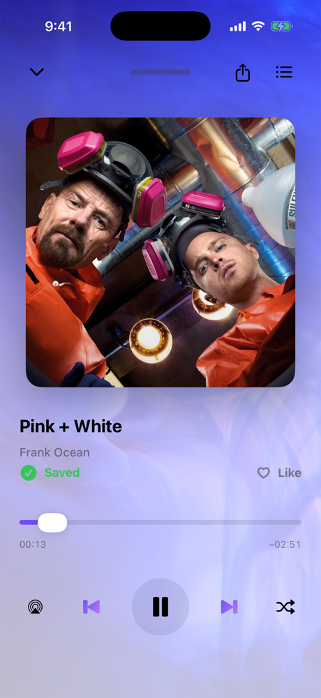
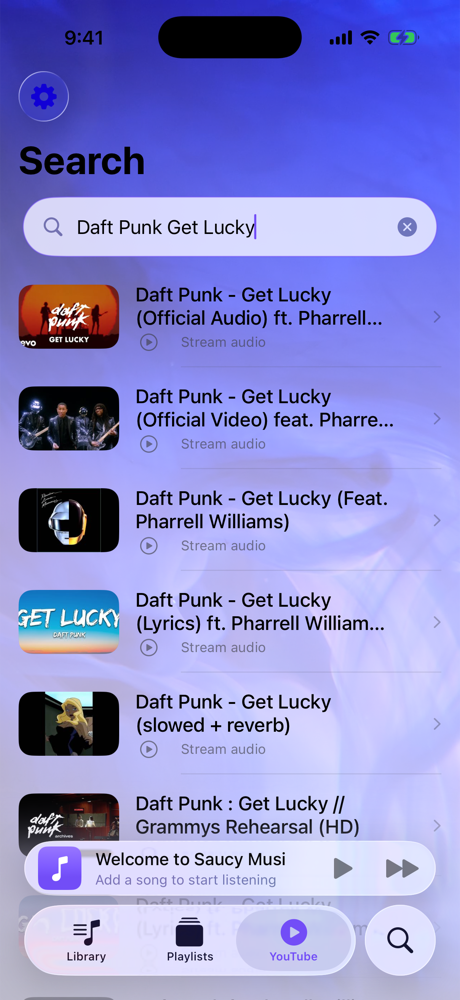
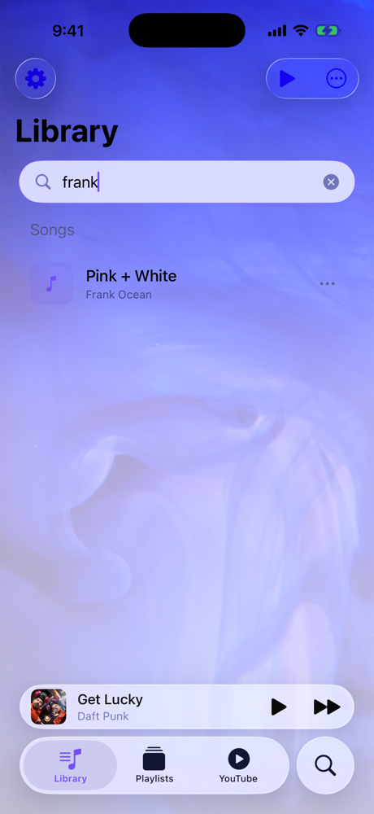

<p align="center">
  
</p>

<h1 align="center">saucyMusi</h1>

<p align="center">
  
  
  
  
  
</p>

A personal iPhone music player built in SwiftUI, paired with a small self-hosted
Python server. Search YouTube from the app, pull the audio down to your own
server, and keep a local library you can play offline, organize into playlists
and share as real audio files.

<p align="center">
  
  &nbsp;
  
  &nbsp;
  
</p>

<p align="center">
  
  &nbsp;
  
</p>

<p align="center">
  <sub>Library · Now Playing · YouTube search · Library search · Settings</sub>
</p>

## Performance at a glance

Measured on real hardware with real data. Full method, charts and
recommendations in **[docs/PERFORMANCE.md](docs/PERFORMANCE.md)**.

| | |
|---|---|
| Replaying a cached song from the server | **0.8 ms** (first fetch from YouTube: 2.3 s) |
| Audio quality delivered | AAC 128 kbps, original stream, never re-encoded |
| Library search per keystroke | **4.5 ms** at 100 songs · **32 ms** at 1,000 |
| Artist read correctly from 120 real YouTube titles, offline | **71 %**, with **91 %** precision |
| Test suite | **76 / 76** unit tests passing, plus 6 UI tests |
| Idle CPU / memory with the animated wallpaper | **28 % / 339 MB**, down from 136 % / 585 MB |
| App size | **24 MB**, down from 47 MB |

The benchmarks found that the 4K wallpaper video kept the CPU busy even when
the app was idle. It now ships at 1080p with the same look: **79 % less idle
CPU, 42 % less memory, and half the app size.**

<p align="center">
  
</p>

## Features

**Playback**
- Background audio with lock-screen / Control Center controls and Now Playing info
- Queue with shuffle and repeat, "Up Next" view
- AirPlay output
- Handles interruptions (calls, Siri) and headphone unplugging gracefully

**Library**
- Songs stored locally on the device and visible in the Files app
- Playlists, swipe actions and context menus
- Fuzzy search across your library
- Trash with restore / empty
- Share a song as an actual `.m4a` / `.mp3` file (AirDrop, Messages, Files),
  named `Artist - Title`

**Smart metadata**
- Guesses artist and title from messy YouTube video names
  (`Artist - Title`, `「Title」`, `feat.` bylines, `|` and `/` separators, …)
- Confirms or corrects guesses with Apple's public iTunes Search API
  (no account or key; only the song title is sent, and it can be turned off)
- Groups anime openings, endings and OSTs under their show rather than
  scattering them across dozens of artists
- Romanizes Japanese artist names

**Look and feel**
- Animated video wallpaper
- Choice of typeface (SF Pro, SF Rounded, New York, SF Mono or the bundled
  Ubuntu font) and adjustable text size

## How it works

```
┌──────────────┐  search   ┌──────────────────┐
│  iPhone app  │ ────────▶ │ YouTube Data API │
│  (SwiftUI)   │           └──────────────────┘
│              │  /get_audio_url?url=…   ┌───────────────────────┐
│              │ ──────────────────────▶ │  Server (Flask +      │
│              │ ◀── audio file ──────── │  yt-dlp, on your Mac) │
└──────────────┘                         └───────────────────────┘
```

The app never downloads from YouTube directly. It asks your server, which uses
[yt-dlp](https://github.com/yt-dlp/yt-dlp) to fetch iPhone-native M4A audio,
caches it, and serves it back with byte-range support. Downloaded songs then
live on the phone and play offline.

## Project layout

```
SaucyMusi/              iOS app source
├── SaucyMusiApp.swift  App entry point
├── Views/              Home (now playing), Library, Playlists, Artists, YouTube search, Settings
├── Services/           AudioManager, storage, metadata parsing, artist lookup, show catalog
├── Navigation/         Tab bar and tab definitions
├── Design/             Typography, theming, video wallpaper
├── Assets.xcassets/    App icon and images
├── Fonts/              Ubuntu font family
├── Resources/          Wallpaper video (1080p loop)
└── PreviewContent/     SwiftUI preview assets
SaucyMusiTests/         Unit tests, benchmarks, real-title fixtures
SaucyMusiUITests/       UI and launch-time tests
Server/                 Flask + yt-dlp audio server and its benchmark
Config/                 Info.plist and example secrets
docs/                   Performance report, charts, screenshots
```

## Getting started

### Requirements

- Xcode 26 or later, iOS 26 SDK
- A Mac (or any machine) with Python 3.10+ to run the server
- A [YouTube Data API v3](https://console.cloud.google.com/apis/credentials) key

### 1. Add your API key

```bash
cp Config/Secrets.swift.example SaucyMusi/Services/Secrets.swift
```

Then open `SaucyMusi/Services/Secrets.swift` and paste in your key. The file is
git-ignored, so the key stays on your machine.

### 2. Start the server

```bash
cd Server
./start_server.sh
```

The script sets up its own virtual environment on first run and prints the
server's local network address (port `5001`). To keep it running in the
background on macOS, edit the paths in `Server/com.saucymusi.server.plist` and load
it with `launchctl`. More detail in [Server/README.md](Server/README.md).

### 3. Run the app

1. Open `SaucyMusi.xcodeproj` in Xcode.
2. Select your own team under **Signing & Capabilities**.
3. Build and run on an iPhone or the simulator.
4. In the app, open **Settings → Audio Server** and enter the address the
   server printed, e.g. `http://192.168.1.20:5001`.

## Running the tests

```bash
xcodebuild test -project SaucyMusi.xcodeproj -scheme SaucyMusi \
  -destination 'platform=iOS Simulator,name=iPhone 17 Pro'
```

The `PerformanceBenchmarks` suite prints `BENCH|name|value|unit` lines. Set
`TEST_RUNNER_BENCH_OUTPUT=/tmp/bench.txt` to collect them in a file. To time
the server, run `python3 Server/benchmark.py <YouTube URL> …` while it is up.

## Tech stack

- **App:** Swift, SwiftUI, AVFoundation, MediaPlayer, CoreTransferable
- **Server:** Python, Flask, yt-dlp
- **APIs:** YouTube Data API v3 (search), iTunes Search API (artist lookup)

## Note

This is a personal project for learning and private use. Only download content
you have the right to download.

## Credits

The [Ubuntu font family](https://design.ubuntu.com/font) is used under the
Ubuntu Font License; see [LICENSES/Ubuntu-Font-License.txt](LICENSES/Ubuntu-Font-License.txt).
