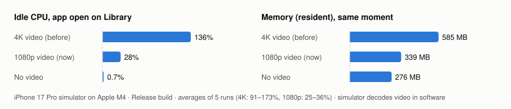
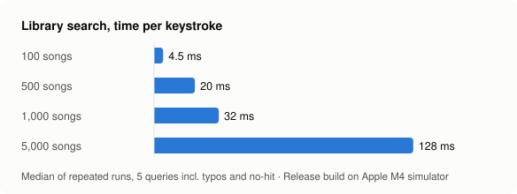
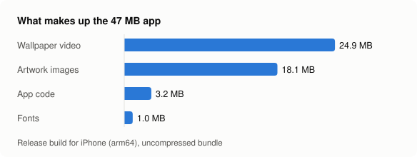

# saucyMusi performance report

Measured on **October 21, 2026**. Every number below comes from a real run on
the hardware listed, not from estimates. The commands to reproduce each one are
at the end.

> **Update:** the top recommendation from this report has been applied. The
> wallpaper video now ships at 1080p without an audio track, and the numbers
> below were re-measured on the new build.

## Summary

| Area | Result | Verdict |
|---|---|---|
| Unit tests | **76 / 76 passing** (71 behaviour + 5 benchmark) | ✅ |
| Repeat song request (server cache hit) | **0.8 ms** median | ✅ ~2,800× faster than a first request |
| First song request (YouTube download) | **2.3 s** median (2.0–3.2 s) | ✅ |
| Audio delivered | AAC 128 kbps / 44.1 kHz, no re-encoding | ✅ |
| Library search, 1,000 songs | **32 ms** per keystroke | ✅ |
| Library search, 5,000 songs | **128 ms** per keystroke | ⚠️ noticeable lag |
| Artist detection offline, 120 real YouTube titles | **71 % correct, 91 % precision** | ⚠️ see misses |
| Idle CPU, animated wallpaper | **28 %**, down from 136 % with the old 4K video | ✅ fixed (−79 %) |
| Idle memory | **339 MB**, down from 585 MB | ✅ fixed (−42 %) |
| App size (iPhone build) | **24.2 MB**, down from 47.3 MB | ✅ halved |

**Most important finding:** the looping 4K background video cost more than
every other part of the app combined. Re-encoding it to 1080p kept the same
look while cutting idle CPU by 79 %, memory by 42 % and the app's size in half.
That change is now in the app.

## Test environment

| | |
|---|---|
| Mac | Apple M4, 16 GB RAM |
| Xcode | 26.0.1 (17A400) |
| Simulator | iPhone 17 Pro, iOS 26 |
| Build | Release (`ENABLE_TESTABILITY=YES` for test runs) unless noted |
| Server | Flask + yt-dlp on the same Mac, port 5001 |

> **Simulator caveat.** The iOS simulator decodes video in software and runs on
> a desktop CPU. Absolute CPU and launch numbers will differ on a real iPhone;
> the comparisons between variants (same machine, same run, alternated) are
> what these tests are designed to show.

---

## 1. Animated wallpaper cost



The app sits idle on the Library screen while the CPU and resident memory of
its process are sampled once per second for 20 seconds. Builds of the same app
were run alternately, in two sessions: first a 4K / 1080p / no-video A/B test,
then the final build with the 1080p video against the old 4K build.

| Wallpaper | Idle CPU (avg) | Memory (avg) | Video file |
|---|---|---|---|
| 4K H.264, 22.5 Mbps, with audio track (before) | 136 % (runs: 173, 105, 91, 149, 159) | 585 MB | 24.9 MB |
| **1080p H.264, 1.6 Mbps, no audio (now)** | **28 %** (runs: 26, 25, 36, 26, 27) | **339 MB** | **1.8 MB** |
| No video (still image, for reference) | 0.7 % (runs: 0.6, 0.7) | 276 MB | — |

The original video was 3840 × 2160, but it is shown behind a phone screen that
is at most 1320 px wide, so three quarters of every decoded frame was thrown
away. It also carried an audio track the app never played (the player is
muted). The 1080p re-encode keeps the same 8.8-second loop and drops the audio.

What's left (28 % vs 0.7 %) is the price of having an animated background at
all. Pausing it while the app is in the background or in Low Power Mode is the
next step if battery matters more than the look.

**Launch time is not affected.** In an A/B run of the launch test (10 launches
each, alternated), the 4K build launched in a median 3.46 s and the
no-video build in 3.97 s, so the video is not the launch bottleneck.

## 2. Library search



Each keystroke in the Library search filters every song by title, artist and
show, with typo tolerance. Five queries are timed at each size: a normal word,
a misspelled artist (`kendrik lamar`), a run-together name (`onepiece`), a typo
(`weird fishs`) and a query that matches nothing.

| Library size | Average | Worst query |
|---|---|---|
| 100 songs | 4.5 ms | 4.9 ms |
| 500 songs | 20 ms | 22 ms |
| 1,000 songs | 32 ms | 43 ms |
| 5,000 songs | 128 ms | 203 ms |

Cost grows linearly at about **30 µs per song**. Most of it is re-normalizing
every song's text on every keystroke (accents, case, punctuation): one
normalization takes 7.5 µs and a keystroke does three per song. Caching each
song's normalized words once would remove that work, which is what large
libraries need to stay under the ~100 ms mark where typing starts to feel late.

## 3. Artist detection

When a song is downloaded, the app reads the artist from the YouTube title
with 13 pattern detectors before (optionally) confirming online. To test this
on real data, the top 4 YouTube search results were collected for **30 songs**
across pop, hip-hop, rock, Latin, Afrobeats, French, K-pop, J-pop and anime,
giving **120 real titles**. Each was run through the offline detector.

| Outcome | Titles | Share |
|---|---|---|
| Correct artist | 85 | 70.8 % |
| No guess | 27 | 22.5 % |
| Wrong artist | 8 | 6.7 % |

**Precision is 91 %.** When the app names an artist without the network, it
is right 9 times out of 10. The misses fall into clear groups:

- **No artist in the title at all (12 of the 27 no-guesses).** Uploads named
  just `Dreams`, `Money Trees`, `Passionfruit` or `紅蓮の弓矢`, mostly from
  auto-generated "Topic" channels. Offline detection can't solve these by
  design; this is what the app's iTunes lookup is for.
- **Fan content (7 no-guesses).** Dance tutorials, reaction videos, a guitar
  lesson, karaoke and fancams, e.g. `NewJeans (뉴진스) 'Super Shy' Lisa Rhee
  Dance Tutorial`. Saying "no guess" here is the right call.
- **"… by Artist" after a long prefix (4 no-guesses).** `Jujutsu Kaisen - OP 1
  Full - Kaikai Kitan by Eve (Lyrics)` gives no guess even though a `by`
  pattern exists.
- **"Title – Artist" read backwards (4 of the 8 wrong).** `Billie Jean -
  Michael Jackson (Lyrics)` and `Rolling In The Deep - Adele (Lyrics)` come
  out with the title as the artist. The detector assumes `Artist – Title`; an
  artist already in the library, or the online check, flips these.
- **Japanese anime labels (the other 4 wrong).** In titles like
  `廻廻奇譚 - Eve MV` or `TVアニメ『呪術廻戦』… King Gnu「SPECIALZ」`, the song or
  show name is taken as the artist.

Speed is not a concern: one title takes **4.1 ms** to analyse and show
detection **1.2 ms**, and both run once per new song.

## 4. Audio server

[`Server/benchmark.py`](../Server/benchmark.py) requested five songs that had
never been downloaded, then repeated each request 20 times.

| Song | First request | Repeat (median) | First audio bytes | File |
|---|---|---|---|---|
| Doja Cat – Paint The Town Red | 3.16 s | 0.80 ms | 1.29 ms | 3.75 MB |
| Mitski – My Love Mine All Mine | 2.27 s | 0.82 ms | 1.06 ms | 2.24 MB |
| Tems – Free Mind | 2.15 s | 0.79 ms | 1.22 ms | 3.99 MB |
| Mac Miller – Good News | 2.29 s | 0.77 ms | 1.21 ms | 6.42 MB |
| Ado – うっせぇわ | 2.00 s | 0.69 ms | 1.11 ms | 3.28 MB |
| **Median** | **2.27 s** | **0.79 ms** | **1.21 ms** | |

- The cache makes a repeat request about **2,800× faster** than the first.
- Every file is **AAC 128 kbps, 44.1 kHz**, YouTube's original audio stream
  copied as-is. Nothing is re-encoded, so there is no quality loss and no
  transcoding delay. That works out to roughly 1 MB per minute of music.
- Byte-range requests are answered in about 1 ms, so playback can start before
  the whole file arrives. Over Wi-Fi the network, not the server, will set the
  real start time.

## 5. App size



The Release build for iPhone (arm64) is now **24.2 MB** uncompressed and
21.0 MB zipped, down from 47.3 MB and 43.9 MB with the 4K video:

| Part | Now | Before | Note |
|---|---|---|---|
| Artwork images | 18.1 MB | 18.1 MB | 15 photos at 1920 × 1080 or larger, shown cropped to a square |
| App code | 3.2 MB | 3.2 MB | |
| Wallpaper video | **1.8 MB** | 24.9 MB | 1080p, no audio (was 4K with an unused audio track) |
| Fonts | 1.0 MB | 1.0 MB | Ubuntu Regular, Medium, Bold |

The artwork is now the largest part. Resized to the ~1,200 px square it is
actually shown at, the app would drop to an estimated **10 MB**.

## 6. Build and codebase

| | |
|---|---|
| Clean build, Debug | 18.4 s |
| Clean build, Release | 30.6 s |
| Incremental build (one view changed) | 3.9 s |
| App source | 6,260 lines of Swift in 24 files |
| Tests | 1,107 lines: 76 unit tests, 6 UI tests |
| Server | 248 lines of Python |

## Recommendations, by impact

1. ~~**Re-encode the wallpaper video to 1080p, without audio.**~~ **Done.**
   79 % less idle CPU, 42 % less memory, 23 MB smaller app, same look. Made with
   `ffmpeg -i wallpaper-ink.mp4 -vf scale=1920:1080 -c:v libx264 -preset slow -crf 23 -pix_fmt yuv420p -an -movflags +faststart out.mp4`
2. **Pause the wallpaper while audio is playing in the background** and when
   Low Power Mode is on.
3. **Resize the artwork photos** to the square size they are displayed at
   (~1,200 px). Saves an estimated 14 MB.
4. **Cache normalized search words per song** so Library search stays under
   100 ms for 5,000+ song libraries.
5. **Teach the artist detector the "Title – Artist" order** when the right
   side is a known artist, and look for `by Artist` anywhere in the title.

## Reproducing these numbers

```bash
# Unit tests + benchmarks (results appended to /tmp/bench.txt)
TEST_RUNNER_BENCH_OUTPUT=/tmp/bench.txt xcodebuild test \
  -project SaucyMusi.xcodeproj -scheme SaucyMusi -configuration Release \
  ENABLE_TESTABILITY=YES -only-testing:SaucyMusiTests \
  -destination 'platform=iOS Simulator,name=iPhone 17 Pro'

# Launch time (5 launches)
xcodebuild test -project SaucyMusi.xcodeproj -scheme SaucyMusi \
  -only-testing:SaucyMusiUITests/SaucyMusiUITests/testLaunchPerformance \
  -destination 'platform=iOS Simulator,name=iPhone 17 Pro'

# Audio server (server must be running)
python3 Server/benchmark.py --server http://127.0.0.1:5001 <YouTube URL> ...
```

CPU and memory were sampled with `ps -o rss=,%cpu=` against the simulator's app
process, once per second for 20 seconds, after an 8-second settle.
